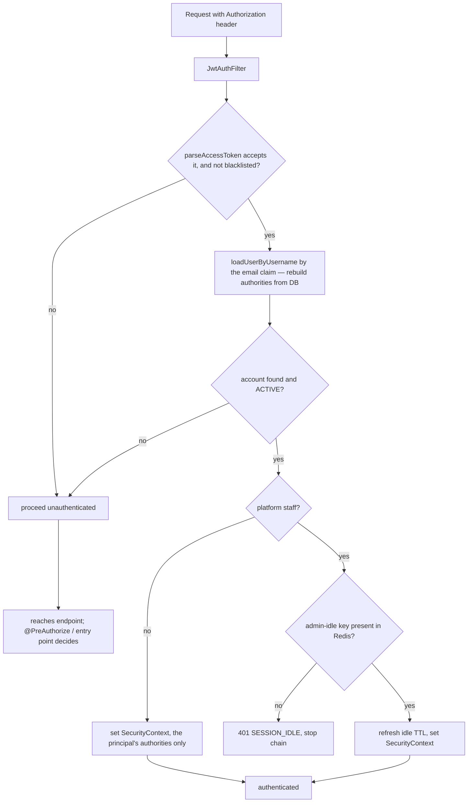
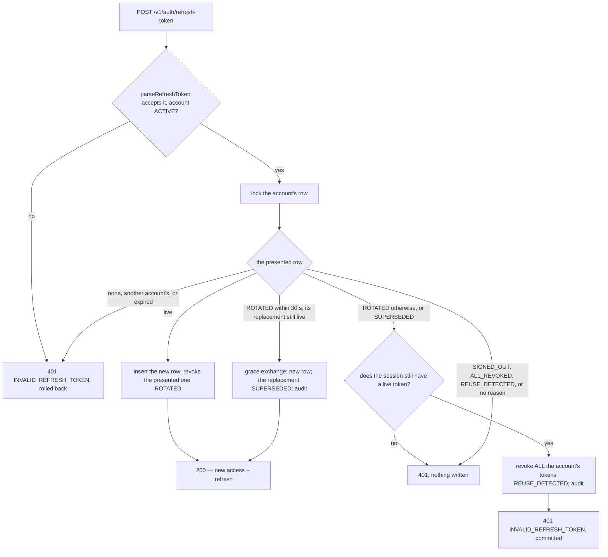

# JWT, sessions & refresh

This page owns the token machinery behind every authenticated CropDoor request: how an access token and a refresh token are minted and signed, how signing keys rotate without logging anyone out, how the filter chain re-authenticates each request, and how refresh-token rotation detects a stolen token and burns the whole session. Everything above the login flows — [login and the phone gate](login-and-the-phone-gate.md), [admin login and MFA](admin-login-and-mfa.md), [OAuth](oauth.md) — ends by calling `JwtProvider` to produce the pair described here, so this is the shared plumbing they all sit on.

Two facts anchor the rest of the page. First, **authorities are never in the token** — the JWT carries identity and a login-`scope`, and permissions are re-resolved from the database on every single request. Second, **only hashes hit disk** — the raw refresh JWT is returned to the client once and never persisted, and the blacklist stores a SHA-256 digest, not the token. All response payloads below are the `data` field of the `ApiResponse<T>` wrapper.

!!! info "Status"
    The parsing, the filter, the refresh and the logout below are as the security fix *Pending invite sign-in* part 2 leaves them (#379, merged 27 Oct 2026, `581fbf01`; live verify passed 66/66; next: the promotion, then the §2.9 deploy step once per environment); the places it changed are marked as part 2's.

## The token pair — `JwtProvider`

`security/jwt/JwtProvider.java` mints both tokens, signing each with HMAC-SHA512 (`HS512`) using the active signing key and stamping the key's `kid` into the JWS header. `JwtProvider#generateToken` builds the access token; `JwtProvider#generateRefreshToken` builds the refresh token. Both take a `CustomUserDetails` and the resolved `LoginContextResponse`, so the token records *which* context the session runs in.

| Claim | Access token | Refresh token | Meaning |
| --- | --- | --- | --- |
| `kid` (header) | yes | yes | Which signing key verifies this token |
| `sub` | yes | yes | Login identifier — email when present, otherwise phone (`CustomUserDetails#getUsername`) |
| `jti` | yes | yes | Random `UUID` per token |
| `iat` / `exp` | yes | yes | Issued-at / expiry, from the injected `Clock` |
| `userId` | yes | yes | The `users` row id |
| `email` | yes | no | Same value as `sub` (email-or-phone); named `email` for historical reasons |
| `type` | no | `"refresh"` | Marks the refresh token; each door checks it (see the parsing below): the refresh door accepts only `"refresh"`, the access door refuses it |
| `scope` | yes | yes | The `LoginContextType` name, e.g. `PLATFORM_ADMIN`, `FARM_MEMBER`, `BUYER_MEMBER`, `DORMANT` |
| `ownerId` / `ownerType` | org contexts only | org contexts only | The owning farm/buyer org for member contexts |

There are **no role or permission claims**. `JwtProvider#generateToken` documents this deliberately: embedding authorities would leak permission codes in any captured token, bloat the token, and go stale the instant a role is edited. Authorization is instead rebuilt per request (next section) and is the canonical topic of [RBAC authorization](../rbac/authorization.md).

### Parsing: one parse, one shape per door

Since part 2 (#379), every token is parsed and verified in one place, `JwtProvider#verifiedClaims`: the key its `kid` names, the signature, and an `exp` not yet passed. The door's shape check then reads the verified claims in the same step. Each door has exactly one way in, and each refuses the other's token (deny-by-default):

| Method | Read by | Accepts only | Returns |
| --- | --- | --- | --- |
| `JwtProvider#parseAccessToken` | `JwtAuthFilter` on HTTP and the chat WebSocket's `CONNECT` alike | a non-blank `email` and `scope` claim, an `exp`, and no `type` of `refresh` | the `email` claim (the principal is loaded by it) and the `exp` |
| `JwtProvider#parseRefreshToken` | `AuthServiceImpl#refreshToken` | a `type` of `refresh`, a non-blank `sub` and an `exp` | the `sub` |

A token that does not verify or has the wrong shape comes back empty, a claim of the wrong type (a number where a string belongs) included, so it is refused rather than answered with a 500. The old `validateToken` and per-claim readers are gone.

### Token lifetimes

TTLs are role-aware. Non-admins use the platform defaults bound under `app.jwt.*` on `JwtKeyConfig`; admins use the tighter `app.security.admin.*` values on `AdminSessionProperties`, which `JwtProvider` reads directly as the authoritative source for admin token lifetimes.

| Principal | Access TTL | Refresh TTL | Source |
| --- | --- | --- | --- |
| Non-admin (`FARMER` / `BUYER` / `STAFF`) | 15 min (`900000` ms) | 7 days (`604800000` ms) | `JwtKeyConfig` (`app.jwt.expiration-ms`, `app.jwt.refresh-expiration-ms`) |
| Admin (`UserType.ADMIN`) | 5 min (`300000` ms) | 1 day (`86400000` ms) | `AdminSessionProperties` (`app.security.admin.access-ttl-ms`, `app.security.admin.refresh-ttl-ms`) |

One subtlety: the persisted `refresh_tokens.expires_at` row is always stamped with the platform default (7 days) in `RefreshTokenServiceImpl`, even for admins, whereas the admin refresh JWT's own `exp` is 1 day. Because `AuthServiceImpl#refreshToken` accepts the token through `JwtProvider#parseRefreshToken` (which checks the signature and `exp`) before the stored row's `expires_at` is ever consulted, the shorter 1-day JWT expiry governs for admins — the longer DB expiry never gets a chance to matter.

## Signing keys & rotation — `JwtKeyProvider`

Keys are configured as a list under `app.jwt.keys[n]`, each a `JwtKeyEntry` with `kid`, `secret`, and `active`. `security/config/JwtKeyConfig.java` binds the list; `security/jwt/JwtKeyProvider.java` loads it at startup (`@PostConstruct init`) into a `kid → SecretKey` map and enforces the invariants — boot fails fast if:

- no keys are configured,
- any secret is shorter than 64 characters (512 bits, the `HS512` minimum), or
- zero or more-than-one entry is marked `active`.

Exactly one key is the **active signing key** (`JwtKeyProvider#getActiveKey`, its id from `getActiveKid`); every configured key — active or retired — remains a **verification key** reachable by `getKey(kid)`. Verification is keyed by the header: `JwtProvider` reads the `kid` out of the JWS header, resolves the matching `SecretKey`, and verifies with it. A token whose `kid` is missing or unknown fails validation outright.

That split is what makes rotation seamless. New tokens sign with the new active key; tokens already in the wild keep verifying against whichever retired key their `kid` names.

The rotation procedure, which invalidates no live token:

1. Add a new `keys[n]` entry: a fresh `kid`, a fresh secret of 64 or more characters, `active = true`.
2. Flip the previous active entry to `active = false`, but keep it in the list.
3. Redeploy: `JwtKeyProvider` now signs with the new `kid` and still verifies the old one.
4. Wait out the longest refresh TTL (7 days), so every token with the old `kid` has expired.
5. Only then remove the retired `keys[n]` entry.

## Per-request authentication — the filter chain

`security/config/SecurityConfig.java` runs a stateless (`SessionCreationPolicy.STATELESS`) filter chain. Three custom filters are registered ahead of Spring's `UsernamePasswordAuthenticationFilter`, in this order:

1. `CorrelationIdFilter` — seeds the MDC with `requestId` first, so every downstream log line correlates.
2. `JwtAuthFilter` — the bearer-token authenticator described below.
3. `AdminPerUserRateLimitFilter` — post-auth per-admin rate limiting (see [admin login and MFA](admin-login-and-mfa.md)).

`security/jwt/JwtAuthFilter.java` (`OncePerRequestFilter`) re-authenticates on **every** request — there is no server session to reuse. Its logic in `authenticateRequest`:

1. Read `Authorization: Bearer <jwt>`. Absent: continue unauthenticated.
2. Accept it through `JwtProvider#parseAccessToken`. Empty (it does not verify, has expired, or is not an access token, a refresh token included), or blacklisted: continue unauthenticated.
3. Load the principal with `CustomUserDetailsService#loadUserByUsername`, by the token's `email` claim. No such account: continue unauthenticated.
4. The account is not ACTIVE (suspended, or a pending invitee): continue unauthenticated, so a suspension takes effect at the next request.
5. Platform staff (the `ROLE_PLATFORM_STAFF` authority, which only an ACTIVE platform membership grants) whose `admin-idle` key is missing: write a 401 and stop the chain.
6. Set the `SecurityContext` with the principal's own authorities.

The load-bearing step is `loadUserByUsername`: `CustomUserDetailsService` re-derives the principal's authorities from the database (`ROLE_ADMIN` / `ROLE_SUPER_ADMIN` plus bare permission codes, or the member's role-permissions) on each call — this is why a revoked permission takes effect on the very next request without re-issuing tokens. The filter adds no authority from the token. Until part 2 (#379) it also added a `SCOPE_<scope>` authority from the `scope` claim. Nothing gated on it, and part 2 removed it: that claim is resolved at sign-in from the live membership, a pending invite included, so an authority derived from it would grant a pending invitee's token whatever came to gate on it. The `scope` claim stays only as part of the access-token shape. Authority resolution is the canonical topic of [RBAC authorization](../rbac/authorization.md).

A benign no-auth case (no token, a bad or expired token, a refresh token, a blacklisted token, an account that is not ACTIVE) does **not** 401 inside the filter — it lets the request proceed unauthenticated so the authorization layer can decide. If the endpoint requires authentication, Spring Security invokes `security/jwt/JwtAuthEntryPoint.java`, which writes a `401` with a deliberately generic `"Unauthorized"` message and `ErrorCode.INVALID_TOKEN`. The concrete Spring Security exception (bad credentials, locked, unknown user) is logged server-side at WARN but never returned, to avoid handing an unauthenticated caller account-enumeration signal.

The admin idle-session gate — the `admin-idle:<userId>` Redis key and its sliding 30-minute TTL — is enforced here but owned by [admin login and MFA](admin-login-and-mfa.md).

## Token blacklist — `JwtBlacklistService`

`security/jwt/JwtBlacklistServiceImpl.java` is a Redis-backed deny-list used to kill an access token before its natural `exp`. It stores the SHA-256 hex digest of the token under `jwt:blacklist:<digest>` with a TTL equal to the token's **remaining** lifetime — so the entry self-expires exactly when the token would have anyway, and Redis never accumulates dead keys. A zero-or-negative remaining TTL is a no-op. `blacklist` increments a metric via `MetricsService#countJwtBlacklist`. `JwtAuthFilter` calls `isBlacklisted` on every request. Blacklisting happens on logout and on refresh (the outgoing access token is blacklisted), both covered below.

## Refresh rotation, the grace window & reuse detection — `RefreshTokenService`

`POST /v1/auth/refresh-token` (`AuthController#refreshToken` → `AuthServiceImpl#refreshToken`) exchanges a refresh token for a brand-new access **and** refresh token pair. The endpoint is unauthenticated (the refresh token is the credential), and the caller may pass the old — even expired — access token in the `Authorization` header so it can be blacklisted on the way out. The `RefreshTokenRequest` body carries the refresh token itself.

The service accepts the token through `JwtProvider#parseRefreshToken`, loads the principal by its `sub` through `CustomUserDetailsService` and refuses an account that is not ACTIVE, mints the new pair (re-resolving the login context so a context change is picked up), then hands the rotation to `RefreshTokenServiceImpl#rotateRefreshToken`, with the principal's user as the owner the stored row must belong to. Raw tokens are never stored — `service/auth/RefreshTokenServiceImpl.java` hashes every token with `util/TokenHasher.java` (SHA-256) and matches on the hash.

This section describes the token chain as rebuilt by the security follow-up (#386, migration V173, 31 Oct 2026).

### One lock per account

Every writer of an account's refresh tokens takes the **account's row first** (`UserRepository#findByIdForUpdate`, a `FOR NO KEY UPDATE` locking query), and only then reads the clock and any token row: a rotation, a logout, a session revoke, and every revoke-all (`revokeAllUserTokens`, called by the password change and reset, both invite accepts, an Admin/Ops suspend, logout-all and the phone change). So the writers of one account queue behind each other, and a revoke-all can no longer miss a token that a rotation commits while it runs. Logins are not held up: their insert takes only a key-share lock, which does not conflict. A rotation whose account has gone is refused.

### Why a row was revoked (V173)

A refresh token row is never deleted when it stops being usable; it is marked revoked and lingers until the cleanup or its expiry. Since V173 it also records **when and why**: `revoked_at`, `revoked_reason`, and, for a row a newer row replaced, `replaced_by`.

| `revoked_reason` | Meaning | `replaced_by` |
| --- | --- | --- |
| `ROTATED` | an ordinary refresh replaced it | the new row |
| `SUPERSEDED` | a grace exchange replaced the token its client never received | the new row |
| `SIGNED_OUT` | a logout or a session revoke ended it | — |
| `ALL_REVOKED` | a revoke-all ended it (password change, logout-all, suspend…) | — |
| `REUSE_DETECTED` | the theft alarm ended it | — |
| none | revoked before V173, or by an older build | — |

Five named checks keep the columns consistent with the `revoked` flag (a live row has no reason; a reason comes with its time; only a rotation or a grace exchange names a successor; no row names itself), and rows revoked before V173 stay valid. A **session** is therefore a chain: the rows of one sign-in linked by `replaced_by`, ending at its one live token.

### The rotation, in order

1. **The account's lock.** No account: refused.
2. **No row** for the hash (garbage or never issued): refused.
3. **Another account's row:** refused.
4. **The row is revoked:** decided by its reason —
    - `ROTATED`: if it was rotated **within 30 seconds** and the row that replaced it is still the session's live token, a **grace exchange** (below); otherwise the theft alarm, or a plain refusal (below).
    - `SUPERSEDED`: the theft alarm, or a plain refusal.
    - `SIGNED_OUT`, `ALL_REVOKED`, `REUSE_DETECTED` or no reason: a plain refusal that writes nothing.
5. **The row has expired:** refused.
6. Otherwise the rotation **inserts its new row, then revokes the presented row** as `ROTATED`, naming the new row, with a conditional update (`RefreshTokenRepository#revokeIfNotYetRevoked`). If that updates nothing, the row was deleted meanwhile (the deploy step), and the refresh is refused.

### The grace window (30 seconds)

A refresh whose reply is lost on a weak signal leaves the client holding the old token. Presenting the token a rotation **just** replaced, within 30 seconds of that rotation, gets a fresh token instead of the theft alarm. The replacement its client never received is revoked as `SUPERSEDED`, naming the new row, and the exchange is audited as `REFRESH_TOKEN_GRACE_EXCHANGE` (the presented, superseded and new row ids), written only if the exchange commits. Only the token the rotation replaced qualifies, and only while its replacement is the session's live token; an older token, or any after 30 seconds, is handled as a replay. The window is `RefreshTokenService#GRACE_WINDOW`, measured either way so that a small clock skew between server instances cannot shrink it.

Two consequences: two simultaneous refreshes of one token now **both answer 200** (the second is a grace exchange), and a client that keeps the earlier answer's token holds a superseded token. The web app refreshes one at a time across tabs (`navigator.locks`), and cropdoor-frontend#308 gives its refresh a ~10 s timeout and one immediate retry, so that a lost reply's retry lands inside the window. A thief who uses the window supersedes the owner's new token, so the owner's next refresh raises the alarm.

### The theft alarm (reuse detection)

A replayed `ROTATED` or `SUPERSEDED` token raises the alarm **only while its session still has a live token**, found by one recursive query (`RefreshTokenRepository#findLiveEndOf`) that follows `replaced_by` from the presented row, with a guard against loops. The alarm revokes every token of the account as `REUSE_DETECTED`, emits `AuditAction.REFRESH_TOKEN_REUSE_DETECTED` with `RefreshTokenReuseContext`, and throws `RefreshTokenReuseDetectedException`, a subtype of `InvalidRefreshTokenException`. If the session has no live token — the alarm already fired, or the session was signed out — the replay gets a plain refusal that writes nothing, so a thief replaying a dead token cannot keep signing the owner out. The alarm leaves access tokens valid until they expire (15 minutes, 5 for staff), a known limitation recorded as a follow-up.

**The revoke-all commits.** `AuthServiceImpl#refreshToken`, `rotateRefreshToken`, `AuthServiceImpl#logout` and `revokeToken` are `@Transactional(noRollbackFor = RefreshTokenReuseDetectedException.class)`: the alarm's refusal commits, so its revoke-all survives it, and every other refusal rolls back whatever was written before it. Any future transactional caller of `revokeToken` must do the same. The audits are published as events and written by the asynchronous `AFTER_COMPLETION` audit listener (the grace exchange only on commit).

**One client message.** Every refusal answers **401 `INVALID_REFRESH_TOKEN`** with the code's default message, "Your session is invalid. Please sign in again.": `InvalidRefreshTokenException#getClientMessage` returns it whichever check failed, and the specific reason ("Refresh token revoked", "Refresh token replayed after its session ended", "Rotated or superseded refresh token replayed", "Superseded refresh token presented at logout"…) stays in the server's log. A token holder cannot tell which check refused it.

On a successful rotation the service also blacklists the old access token for its remaining TTL, refreshes the admin idle key for admin principals, and audits `TOKEN_REFRESH`.

## Sessions & logout

Each sign-in is a **session**: a chain of refresh token rows linked by `replaced_by`, ending at its one live token, which carries `deviceInfo`, `ipAddress` and `lastUsedAt` (`model/user/RefreshToken.java`, table `refresh_tokens`). Ending a session means revoking its live token.

| Operation | Endpoint | Effect |
| --- | --- | --- |
| List sessions | `GET /v1/auth/sessions` | Every live (non-revoked) row for the caller as `SessionResponse`; pass `?currentRefreshToken=` to flag the caller's own row `current = true` |
| Revoke one session | `DELETE /v1/auth/sessions/{sessionId}` | Ends that session: if the row named has since been rotated, follows the session to its live token and revokes that (`SIGNED_OUT`); `404 SessionNotFound` if it is not the caller's (never leaks another user's session) |
| Logout (this device) | `POST /v1/auth/logout` | Blacklists the access token; ends the session of the refresh token in the body, only if it is the caller's own (a live token is revoked, a rotated one is followed to its live token); audits `LOGOUT`. **A superseded token whose session is still live raises the theft alarm**: every token of the account is revoked, the answer is 401 `INVALID_REFRESH_TOKEN`, and the access token is still blacklisted and `LOGOUT` still audited |
| Logout everywhere | `POST /v1/auth/logout-all` | `revokeAllUserTokens` (every token `ALL_REVOKED`) + blacklists the current access token; audits with scope marker `all_devices` |

`GET /v1/auth/sessions` maps rows through `mapper/auth/RefreshTokenMapper.java`; the `current` flag is computed by hashing the caller-supplied refresh token and comparing to each stored `tokenHash` (passing no token flags every row not-current). `deviceLabel` is presently just an alias of `deviceInfo`.

The two logout endpoints are distinct routes, not one endpoint with a `scope` parameter — `all_devices` is only an internal audit-scope marker on `LogoutScopeContext`, surfaced through the emitter, not a request field. `logout` tolerates a missing refresh token (it still blacklists the access token); `logout-all` needs no body. The web app's sign-out clears its session whatever the answer, so logout's new 401 needs no client change.

Finally, a **password change** (`POST /v1/auth/change-password`, `AuthServiceImpl#changePassword`) verifies the current password, re-hashes the new one, and calls `revokeAllUserTokens` — every session dies and the user must log in again. Password *reset* (forgot-password flow) does the same. Those flows are detailed in [OTP & password recovery](otp-and-password-recovery.md).

### Cleanup cron

`RefreshTokenServiceImpl#cleanupExpiredTokens` runs every 6 hours (`cron = "0 0 */6 * * *"`) and hard-deletes rows whose `expires_at` has passed — this is what eventually reaps the revoked-but-lingering rows that reuse detection relies on within their window.

## Where it lives

| Concern | Source |
| --- | --- |
| Token minting, claims, HS512 signing, TTL resolution, the one parse per door | `security/jwt/JwtProvider.java` |
| Signing/verification key map + rotation invariants | `security/jwt/JwtKeyProvider.java` |
| Key config binding | `security/config/JwtKeyConfig.java`, `security/config/JwtKeyEntry.java` (`app.jwt.*`) |
| Admin TTL / idle knobs | `security/ratelimit/AdminSessionProperties.java` (`app.security.admin.*`) |
| Per-request auth + admin idle gate | `security/jwt/JwtAuthFilter.java` |
| Authority re-resolution | `security/CustomUserDetailsService.java`, `security/CustomUserDetails.java` |
| Filter ordering, stateless policy, entry point wiring | `security/config/SecurityConfig.java` |
| 401 on missing/invalid token | `security/jwt/JwtAuthEntryPoint.java` |
| Access-token blacklist (Redis) | `security/jwt/JwtBlacklistServiceImpl.java` |
| Refresh rotation, the grace window, reuse detection, session revocation | `service/auth/RefreshTokenServiceImpl.java` (the window: `RefreshTokenService#GRACE_WINDOW`) |
| The conditional revoke, the revoke-all and a session's live token | `repository/user/RefreshTokenRepository.java` (`revokeIfNotYetRevoked`, `revokeAllByUser`, `findLiveEndOf`) |
| The account lock every token writer takes | `repository/user/UserRepository.java` (`findByIdForUpdate`) |
| Why a row was revoked: `revoked_at`, `revoked_reason`, `replaced_by` and their checks | `db/migration/V173__refresh_token_revocation.sql`; the reasons are `RefreshToken.RevokedReason` |
| The refresh refusals and their one client message | `exception/InvalidRefreshTokenException.java`, `exception/RefreshTokenReuseDetectedException.java` |
| Refresh-token hashing (SHA-256 at rest) | `util/TokenHasher.java` |
| Blacklist-digest hashing (inline SHA-256) | `security/jwt/JwtBlacklistServiceImpl.java` |
| Refresh/logout/session endpoints | `controller/auth/AuthController.java` |
| Session + refresh DTOs | `dto/auth/response/SessionResponse.java`, `dto/auth/request/RefreshTokenRequest.java` |
| Session mapping | `mapper/auth/RefreshTokenMapper.java` |
| Refresh-token entity + table | `model/user/RefreshToken.java` (`refresh_tokens`) |
| Reuse audit context; the grace exchange audit | `service/platform/audit/context/RefreshTokenReuseContext.java`; `AuditEmitter#refreshTokenGraceExchanged` (`REFRESH_TOKEN_GRACE_EXCHANGE`) |
| Password bcrypt encoder bean | `security/config/CryptoConfig.java` |

## See also

- [Principal model](principal-model.md) — what the `userId`/`scope`/`ownerType` claims resolve to.
- [Login and the phone gate](login-and-the-phone-gate.md) — the standard login that mints this pair.
- [Admin login and MFA](admin-login-and-mfa.md) — the admin-specific TTLs and the idle-session gate.
- [OAuth](oauth.md) — the one-time-code exchange that ends in the same token pair.
- [RBAC authorization](../rbac/authorization.md) — how per-request authorities are resolved and gated.
- [Audit](../audit/index.md) — where `LOGOUT`, `TOKEN_REFRESH`, `REFRESH_TOKEN_GRACE_EXCHANGE` and `REFRESH_TOKEN_REUSE_DETECTED` land.
