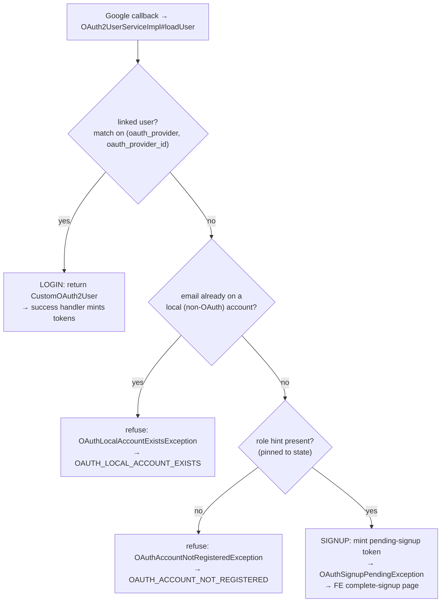
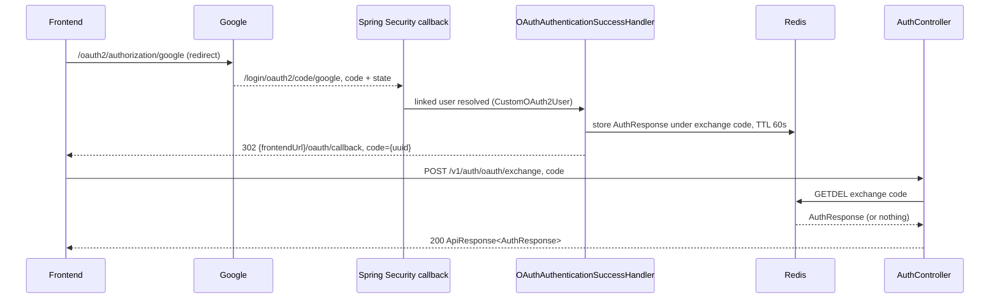
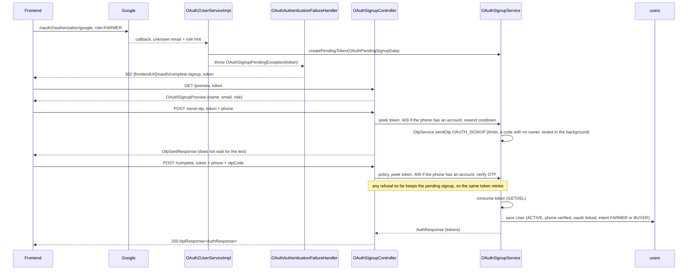

# OAuth (Google)

CropDoor lets a person sign in — or sign up — with their Google account. The heavy lifting rides on Spring Security's `oauth2Login`, but three CropDoor-specific concerns bolt onto it: a **role intent** (`FARMER` vs `BUYER`) has to survive the round trip to Google, a successful login has to converge on the same [`AuthResponse`](index.md) every other path returns, and a brand-new Google identity still has to **verify a phone number** before an account is minted — the same phone-verification discipline the [phone gate](login-and-the-phone-gate.md) enforces on password login, applied up front.

This page walks the whole Google surface: the single callback that fans out into login, signup, or refusal; how the role hint is pinned to the OAuth `state`; the one-time code exchange that hands the browser its tokens; and the phone-verified signup-completion flow driven by `OAuthSignupController`. OTP mechanics themselves live on [OTP & password recovery](otp-and-password-recovery.md); JWT and refresh-token issuance live on [JWT, sessions & refresh](jwt-sessions-and-refresh.md).

## The one callback, four outcomes

Every Google return lands on Spring Security's callback (`/login/oauth2/code/google` — derived from the configured `redirect-uri` template `{baseUrl}/login/oauth2/code/{registrationId}`), which invokes `OAuth2UserServiceImpl#loadUser` — the fork in the road. It loads the Google profile (needs `sub` + `email`, else `invalid_oauth_profile`), lowercases the email, reads any pinned role hint, and branches:

The distinction that matters:

- **Login** is the only outcome where a `User` already exists and is returned. Existing linked account, matched on the `(oauth_provider, oauth_provider_id)` pair — never on email alone.
- **Signup** never creates the `User` here. It stages a snapshot and throws, handing the browser off to the phone-verification flow below. The account is minted only at `POST /v1/auth/oauth/signup/complete`.
- **Refusal** splits by intent so the FE can show accurate copy. An email that already belongs to a **local (password) account** is refused with `OAUTH_LOCAL_ACCOUNT_EXISTS` ("sign in with your password and link Google from settings") — CropDoor never silently auto-links, because an email collision could be an account-takeover attempt. An **unknown** email with **no role hint** (Google clicked from a plain `/login` button, not a role-scoped signup button) is refused with `OAUTH_ACCOUNT_NOT_REGISTERED` — there is nothing to log into and no signal of what kind of account to create. CropDoor never auto-creates a `User` from Google alone, because the `users` schema requires a phone number Google does not supply.

`OAuthService` / `OAuthServiceImpl` are vestigial: `processOAuthUser` throws `UnsupportedOperationException` and `getAuthorizationUrl` just returns the path string. All real resolution lives in `OAuth2UserServiceImpl`.

## Carrying the role intent through the handshake

Google's authorization request has no field for "the user clicked the *Sign up as a farmer* button." CropDoor threads that intent through the OAuth `state` parameter — the one value Spring generates per request and echoes back unchanged on the callback.

The FE starts the flow at `GET /oauth2/authorization/google?role=FARMER` (or `?role=BUYER`). `RoleAwareOAuth2AuthorizationRequestResolver` wraps Spring's default resolver (rooted at the default `/oauth2/authorization` base URI): it reads the `role` query parameter, and on the generated authorization request it stores the role under that request's `state` value in Redis via `OAuthRoleStateStore#store`. Two guardrails apply:

- **Only a `RegistrationIntent` value is pinned, and it grants nothing.** The resolver reads `role` case-insensitively as a `RegistrationIntent` (`FARMER`, `BUYER` or `DRIVER`). Any other value, `ADMIN` included, is discarded with a WARN and no hint is pinned, so the callback treats the return as a sign-in: an unknown email is refused with `OAUTH_ACCOUNT_NOT_REGISTERED`. There is no admin intent to smuggle, and an intent is only an onboarding hint, never a role or a permission ([Principal model](principal-model.md)). `DRIVER` is a value of the enum, so a hand-made `?role=driver` is pinned; signup completion keeps only `FARMER` or `BUYER` and saves anything else as no intent (below).
- **Role never reaches Google.** It is stashed server-side keyed by `state`, *not* added to `getAdditionalParameters()` — Spring forwards those to the provider, and Google would reject an unrecognized parameter.

On the callback, `OAuth2UserServiceImpl#readRolePending` pulls the `state` parameter back off the request and calls `OAuthRoleStateStore#consume`, which does an atomic read-and-delete (`GETDEL`) — the hint is single-use. No hint means the sign-in flow (login), not sign-up. If the servlet request context is absent, it safely defaults to "no hint."

Three short-lived Redis stashes underpin the whole surface, each single-use:

| Redis key | Holds | TTL | Written by | Consumed by |
| --- | --- | --- | --- | --- |
| `oauth-pending-role:{state}` | the role hint (`FARMER` or `BUYER` from the sign-up buttons) | 10 min (`app.oauth.role-state-ttl-seconds`, default `600`) | `RoleAwareOAuth2AuthorizationRequestResolver` | `OAuth2UserServiceImpl#readRolePending` (read-and-delete) |
| `oauth-pending-signup:{token}` | `OAuthPendingSignupData` JSON (Google profile + role) | 10 min (`app.oauth.signup-pending-ttl-seconds`, default `600`) | `OAuth2UserServiceImpl` (on the signup branch) | preview, send-otp and complete *peek*; complete *consumes*, only once the code is accepted |
| `auth:oauth-exchange:{code}` | serialized `AuthResponse` | 60 s (`app.oauth.exchange-ttl-seconds`, default `60`) | `OAuthAuthenticationSuccessHandler` | `POST /v1/auth/oauth/exchange` (read-and-delete) |

## OAuth login: success handler and the code exchange

When `loadUser` returns a linked user, Spring wraps it in `CustomOAuth2User` (which carries the local `User` plus the raw Google attributes) and fires `OAuthAuthenticationSuccessHandler`. That handler cannot simply reply with JSON — it is terminating a browser redirect, so it hands the payload off through a one-time code:

1. Resolve the `LoginContextResponse` (`LoginContextResolver`), mint an access JWT + refresh token (`JwtProvider`), and persist the refresh token (`RefreshTokenService`) with the User-Agent + client IP.
2. Build the unified `AuthResponse` (`outcome = AUTHENTICATED`, tokens, `UserSummary`, context, effective permission codes).
3. Store that `AuthResponse` under a random UUID exchange code in Redis for 60 seconds (`OAuthExchangeService#storeCode`).
4. Emit the login audit and 302 the browser to `{app.frontend.url}/oauth/callback?code={uuid}`.

The frontend, now back on its own origin, swaps the opaque code for the real payload:

`POST /v1/auth/oauth/exchange` takes `OAuthExchangeRequest` (`{ "code": ... }`) and calls `OAuthExchangeService#exchange`, which does an atomic `GETDEL`. The code is **single-use and short-lived**: a missing, expired, or already-redeemed code throws `OAuthCodeInvalidException` → HTTP 401 `OAUTH_CODE_INVALID`. This keeps tokens out of the redirect URL (and out of browser history / referrer logs) while still delivering them to a pure-JSON client. The endpoint is unauthenticated — no session exists yet.

## OAuth signup: phone verification before the account exists

A Google identity is not enough to open a CropDoor account — the schema demands a verified phone. So the signup branch stages the Google profile and forces a phone-OTP round trip before any `User` row is written.

On the signup branch, `loadUser` builds an `OAuthPendingSignupData` snapshot (provider, provider `sub`, lowercased email, `given_name` / `family_name` / `name`, `picture`, whether Google reported `email_verified`, and the pinned role), stores it under a pending-signup token (`OAuthSignupService#createPendingToken`, 10-min TTL), and throws `OAuthSignupPendingException` carrying that token. `OAuthAuthenticationFailureHandler` recognizes this exception (by walking the cause chain) and 302s the browser to `{app.frontend.url}/oauth/complete-signup?token={pendingToken}` — a redirect that looks like a "failure" to Spring Security but is really the start of a second flow.

`OAuthSignupController` (`/v1/auth/oauth/signup`, all endpoints unauthenticated — no session exists yet) drives the rest:

| Method + path | Body | Effect |
| --- | --- | --- |
| `GET /preview` | `?token=` | Non-consuming *peek*; returns `OAuthSignupPreview` (`email`, `firstName`, `lastName`, `displayName`, `picture`, `role`) so the FE renders a "Hi {name}, finish setting up" header. |
| `POST /send-otp` | `OAuthSignupSendOtpRequest` (`token`, `phone`) | Peeks the token (410 when it is gone), normalizes the phone (400 when invalid), rejects a phone that already has an account (409), then spends the phone's 60-second resend cooldown (429). Only then does `OtpService#sendOtp` count the send limits and text an `OAUTH_SIGNUP` code, in the background, to the phone, which no account holds. Returns `OtpSentResponse` at once. |
| `POST /complete` | `OAuthSignupCompleteRequest` (`token`, `phone`, `otpCode`, the accepted policy versions) | Checks the policy versions, peeks the token, rejects a taken phone, verifies the OTP, and only then consumes the token; creates the `User` with the chosen intent, mints tokens; returns `AuthResponse`. |

The `preview` and `send-otp` calls **peek** (read without delete), so they stay idempotent on retry. `complete` peeks too, and **consumes** (atomic delete) the pending token only once the code is accepted, just before the account is made. Every refusal before that leaves the pending signup in place, so the person retries with the same token instead of going back to Google. The consume is still the one gate before an account is made, so a single Google signup can never mint two accounts, even if `complete` is replayed or two run at once. End to end:

**The sign-up code reaches a phone with no account** (#343). The OAuth sign-up is the one purpose whose code goes to a phone *no* account holds; every other purpose still sends nothing to an unknown phone, so no door tells whether a phone has an account ([OTP & password recovery](otp-and-password-recovery.md)). The code row has no owner (`user_id` is null), the text goes out in the background, so the 200 never waits for the provider, and no `OTP_SENT` audit is written, because there is no account to audit. A provider failure is logged at ERROR with only the phone's last four digits and counted in `cropdoor.otp.dispatch.abandoned{purpose="OAUTH_SIGNUP", channel="SMS"}`; the person taps send again after the cooldown. The cooldown is spent only after the pending signup and the free phone are confirmed, so a caller without a live pending signup always gets 410, a taken phone always gets 409, and neither can hold a phone's one-text-a-minute slot.

`OAuthSignupService#complete` is `@Transactional(noRollbackFor = {InvalidOtpException, OtpMaxAttemptsExceededException})`, so a wrong guess's count commits although the request is refused. It does the work in a fixed order:

1. **The accepted policy versions** — 400 `POLICY_ACCEPTANCE_REQUIRED` when they are not current.
2. **Peek the pending signup** (`GET`) — 410 `OAUTH_SIGNUP_TOKEN_EXPIRED` when it is missing or expired. Nothing else is looked at, so a caller without a live pending signup never learns whether a phone has an account, and never spends a phone's guesses.
3. **Normalize the phone** — 400 `VALIDATION_FAILED` when invalid.
4. **Reject a phone with an account** — `PhoneAlreadyRegisteredException`, 409 `PHONE_ALREADY_REGISTERED`.
5. **Verify the OTP** (`OtpService#verifyOtp`, purpose `OAUTH_SIGNUP`).
6. **Consume the pending signup** (`GETDEL`). If it went between step 2 and here (it expired, or a concurrent `complete` took it), the answer is 410 and the transaction rolls back, undoing the code's verification, so the code stays live for a fresh pending signup.
7. **Build the `User`.**

Each refusal and what it leaves:

| Refusal at `complete` | Answer | The pending signup |
| --- | --- | --- |
| Policy versions not current | 400 `POLICY_ACCEPTANCE_REQUIRED` | kept |
| Pending signup missing or expired | 410 `OAUTH_SIGNUP_TOKEN_EXPIRED` | gone already (restart Google) |
| Invalid phone | 400 `VALIDATION_FAILED` | kept |
| Phone has an account | 409 `PHONE_ALREADY_REGISTERED` | kept: "use a different phone" works |
| Verify limit spent (5 per 15 min) | 429 `RATE_LIMIT_EXCEEDED`, `Retry-After` | kept |
| No live code (none sent, expired, used, killed) | 400 `OTP_EXPIRED` | kept: send again |
| Wrong code | 400 `INVALID_OTP` | kept: type again |
| The sixth wrong guess | 429 `OTP_MAX_ATTEMPTS`, the codes killed | kept: send again |
| Pending signup gone between the peek and the consume | 410 `OAUTH_SIGNUP_TOKEN_EXPIRED` | spent, no account; the code stays live |

Two `complete`s racing on one token make exactly one account: the loser answers 410 (or 400 `OTP_EXPIRED`, if it reads the codes after the winner has committed) and rolls back. A failure after the consume (rare: the email registered elsewhere meanwhile) still spends the pending signup.

The new row is stamped `status = ACTIVE`, `oauthProvider` / `oauthProviderId` from Google, `avatarUrl` from the picture, `emailVerifiedAt = now` only if Google reported `email_verified`, and `markPhoneVerified(now)` — so the account lands **already phone-verified** and never trips the phone gate on its first login. **It keeps the Farmer or Buyer choice** (#343): `registrationIntent` is the pending signup's role when that is `FARMER` or `BUYER`, so the web app opens the chosen onboarding form instead of asking again. Any other hint, such as a hand-made `DRIVER`, is saved as no intent (`null`), the waitlist claim's rule: an onboarding hint never fails a signup, and `null` means the web app asks. Names come from Google's `given_name` / `family_name`, falling back to splitting the display `name`, and finally to `Friend` / `User` placeholders (`NameSplitter`). It then mints the token pair, persists the refresh token, audits, and returns the `AuthResponse` directly — no exchange-code detour is needed here because the FE is already inside a JSON request/response cycle.

A stale, expired, or already-consumed pending token throws `OAuthSignupTokenExpiredException` → HTTP 410 `OAUTH_SIGNUP_TOKEN_EXPIRED`, telling the FE to restart the Google flow. The pending signup lives 10 minutes from the Google callback; neither a send nor a refusal extends it.

## Failure redirects

Everything that is not a clean login or a pending signup ends in a redirect to `{app.frontend.url}/oauth-error?code=...`. `OAuthAuthenticationFailureHandler` resolves the code by walking the exception cause chain:

| Redirect `code` | Cause | Meaning for the user |
| --- | --- | --- |
| `OAUTH_LOCAL_ACCOUNT_EXISTS` | `OAuthLocalAccountExistsException` | Email already has a password account — sign in and link from settings. |
| `OAUTH_ACCOUNT_NOT_REGISTERED` | `OAuthAccountNotRegisteredException` | No account and no role intent — go register. |
| `OAUTH_SESSION_EXPIRED` | Spring `authorization_request_not_found` / `invalid_state_parameter` | Stale callback replay (browser back / refresh / prefetch after the `state` was already consumed). |
| `OAUTH_FAILED` | catch-all | Genuine network / provider failure, or an unexpected principal at the success handler. |

These are FE-routing hints carried on a redirect URL — distinct from the `ApiResponse` error codes returned by the JSON endpoints (`OAUTH_CODE_INVALID`, `OAUTH_SIGNUP_TOKEN_EXPIRED`, `PHONE_ALREADY_REGISTERED`).

## Audit

Both OAuth terminals emit through the typed [`AuditEmitter`](../audit/index.md):

- **Login** — `OAuthAuthenticationSuccessHandler` calls `oauthLoginSucceeded(OAuthLoginContext)`, which publishes the standard `LOGIN` action with the device + IP and a `source = "oauth"` discriminator key (an OAuth login is not a distinct action, just a differently-sourced login).
- **Signup** — `OAuthSignupService#complete` calls `oauthSignupCompleted(OAuthSignupContext)`, publishing the dedicated `OAUTH_SIGNUP` action with the `provider`, provider `sub`, and IP alongside the freshly-created user. The sign-up code itself writes no `OTP_SENT`, `OTP_VERIFIED` or `OTP_FAILED`, because it has no owner; its record is the `otp_codes` row (purpose `OAUTH_SIGNUP`, its attempts and delivery status).

## Where it lives

| Concern | Source |
| --- | --- |
| Login-vs-signup-vs-refuse resolution | `service/auth/OAuth2UserServiceImpl.java` (`#loadUser`) |
| Local `User` + Google attributes adapter | `security/oauth/CustomOAuth2User.java` |
| Role hint pinned to OAuth `state` | `security/oauth/RoleAwareOAuth2AuthorizationRequestResolver.java`, `OAuthRoleStateStore.java` |
| Success → tokens → exchange code → FE redirect | `security/oauth/OAuthAuthenticationSuccessHandler.java` |
| Failure → error-code / pending-signup redirect | `security/oauth/OAuthAuthenticationFailureHandler.java` |
| One-time code exchange | `service/auth/OAuthExchangeService.java`, `controller/auth/AuthController.java` (`#exchangeOAuthCode`) |
| Signup completion endpoints | `controller/auth/OAuthSignupController.java` |
| Pending-signup token + user creation | `service/auth/OAuthSignupService.java`, `OAuthPendingSignupData.java` |
| Request / response DTOs | `dto/auth/request/OAuthExchangeRequest.java`, `OAuthSignupSendOtpRequest.java`, `OAuthSignupCompleteRequest.java`, `dto/auth/response/OAuthSignupPreview.java` |
| Vestigial service metadata | `service/auth/OAuthService.java`, `OAuthServiceImpl.java` |
| OAuth2 login wiring (resolver, user service, handlers) | `security/config/SecurityConfig.java` |
| Audit contexts | `service/platform/audit/context/OAuthLoginContext.java`, `OAuthSignupContext.java` |
| Google client + frontend URL config | `spring.security.oauth2.client.registration.google.*`, `app.frontend.url`, `app.oauth.*` (`application.properties`) |

## See also

- [Authentication overview](index.md) — the unified `AuthResponse` and the login-outcome state machine.
- [Login & the phone gate](login-and-the-phone-gate.md) — the phone-verification discipline OAuth signup applies up front.
- [OTP & password recovery](otp-and-password-recovery.md) — how the `OAUTH_SIGNUP` OTP is generated, hashed, and dispatched.
- [JWT, sessions & refresh](jwt-sessions-and-refresh.md) — the token pair the success handler and signup completion mint.
- [Principal model](principal-model.md) — the `User` that a Google identity resolves to or creates.
- [Audit logging](../audit/index.md) — the `LOGIN` (source `oauth`) and `OAUTH_SIGNUP` events.
