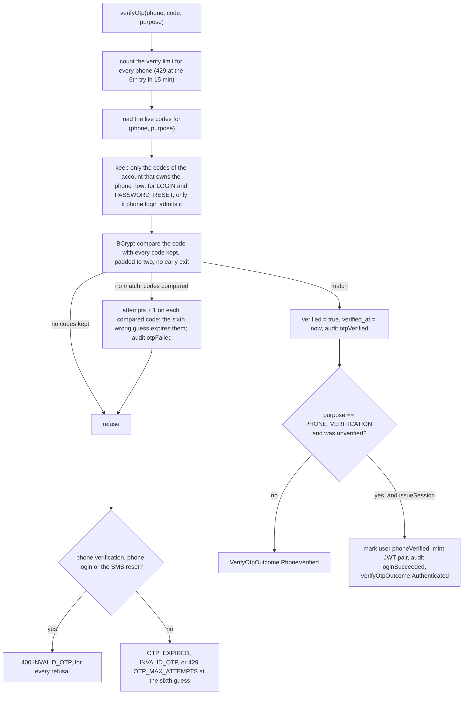
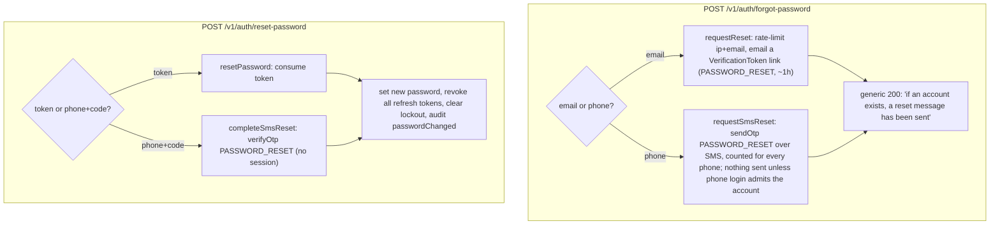

# OTP & password recovery

This page owns two related concerns. First, the **one-time-password (OTP) machinery** — how a six-digit code is generated, hashed, stored, delivered over SMS or voice, rate-limited, verified, and eventually purged. Every OTP-driven flow in the section — phone verification, passwordless login, OAuth signup, admin MFA, and SMS password reset — funnels through the same `OtpService`, so its internals are documented here once and referenced elsewhere by use. Second, **password recovery** — the forgot / reset / change-password endpoints, which share the same anti-enumeration and session-revocation discipline.

If you are looking for the *phone-verification gate* itself (when an unverified phone blocks a login), that arc lives on [Login & the phone gate](login-and-the-phone-gate.md); the *magic-login OTP* dev shortcut is on [Admin login & MFA](admin-login-and-mfa.md). This page explains the code underneath all of them.

## The OTP row: one active code per (phone, purpose)

An OTP is a row in `otp_codes` (`model/user/OtpCode.java`, table shaped by `V27__redesign_otp_codes.sql` and `V29__add_sms_delivery_status_to_otp_codes.sql`). The **raw code is never persisted** — only a BCrypt hash in `code_hash`, produced by the same `PasswordEncoder` bean used for account passwords. Each row is scoped by `purpose` (`model/user/OtpPurpose.java`) and `sent_via` (`model/user/OtpChannel.java`), and bounded by `attempts` and `expires_at`.

At most **two** codes are live per `(phone, purpose)`: the newest one and the code sent just before it. Before inserting a fresh code, `OtpServiceImpl#reserveOtpRow` calls `OtpCodeRepository#invalidateActiveCodesExceptNewest`, which sets `expires_at = now` on every older unverified row for that phone and purpose. This lets a code still in transit work after a resend. A verify loads every live row (`findAllActiveByPhoneAndPurpose`). **Only the codes of the account that owns the phone now are compared** (#391): a previous holder's codes, and any code on a phone with no account, are set aside, not compared, counted or consumed. So a code sent before a number changed hands never works for its new holder.

| Constant (`OtpServiceImpl`) | Value | Meaning |
| --- | --- | --- |
| `OTP_LENGTH` | 6 | Digits, drawn one at a time from `SecureRandom`. |
| `OTP_TTL` | 10 minutes | Sets `expires_at`; surfaced to clients as `expiresInSeconds`. |
| `MAX_VERIFY_ATTEMPTS` | 5 | Wrong guesses a code survives. The **sixth** wrong guess expires every code it was compared with (the kill), and a right code afterwards answers as no code. |
| `SEND_PER_PHONE_MAX` / window | 5 / hour | Sends per phone number **and purpose** (`otp-send:<purpose>:phone`). |
| `SEND_PER_IP_MAX` / window | 10 / hour | Sends per client IP (skipped when IP is null). **One ceiling shared** by the four anonymous purposes (phone verification, phone login, the SMS reset, the OAuth sign-up) and register (`otp-send:ip`); MFA and the phone change each have their own. |
| `VERIFY_PER_PHONE_MAX` / window | 5 / 15 min | Verify attempts per phone number. **One limit shared** by the three doors that open an account (phone verification, phone login, the SMS reset: `otp-verify:phone`); MFA, the phone change and the OAuth sign-up each have their own (`otp-verify:<purpose>:phone`). |
| `RESEND_COOLDOWN` | 60 s | One send per phone **and purpose** per minute (`otp-resend:<purpose>:phone`), so the cooldown is per door. |

Every bucket goes through `ScopedRateLimiter` (`security/ratelimit/ScopedRateLimiter.java`), a Redis `INCR` + conditional `EXPIRE` keyed as `rl:{scope}:{identifier}`. On exhaustion it throws `RateLimitExceededException` (HTTP 429 `RATE_LIMIT_EXCEEDED`) carrying the key's remaining TTL as `Retry-After`. **The scope is chosen by purpose** (#391), through exhaustive switches in `OtpServiceImpl` (`ipScopeFor`, `verifyScopeFor`), with the purpose written lower case with hyphens (`phone-verification`, `login`, `mfa`, `password-reset`, `oauth-signup`, `phone-change`). Every key stays under `rl:otp-send:`, `rl:otp-verify:` or `rl:otp-resend:`. No anonymous door can reach the MFA step's keys.

## Sending a code: the two-phase dispatch

There are two sends. Both reserve the row and call the provider the same way. They differ in who may receive a code and in whether the caller waits.

- **`OtpServiceImpl#sendOtp`, the anonymous doors' send** (phone verification, phone login, the SMS reset, the OAuth sign-up). It works in a fixed order, the same for every phone:
  - It **counts the limits first**, for every phone: the IP scope and `otp-send:<purpose>:phone`. A sixth send in an hour is 429 whoever the phone belongs to.
  - **Then it decides who the code reaches.** An unknown phone, or an account the purpose may not reach, gets `OtpSendResult.DISPATCHED` and nothing is sent. Phone login and the SMS reset reach only accounts phone login admits: ACTIVE and not platform staff. A phone already verified, at `PHONE_VERIFICATION`, gets `ALREADY_VERIFIED`, the one case a client may tell apart (it skips the OTP-entry screen).
  - **The text goes out in the background.** `dispatchInBackground` is `@Async`, and runs after the request's commit when there is one. The answer, and its timing, never depend on whether a text was sent.
  - **A provider failure is never an answer here.** The request is still 200 `DISPATCHED`. The dropped text is logged at ERROR, naming only the purpose, the channel and the phone's last four digits, and counted in `cropdoor.otp.dispatch.abandoned{purpose, channel}`. That covers an account gone by then too.
- **`OtpServiceImpl#sendOtpToUser`, the send for callers that already hold the account:** register and its resume, the password login's phone gate, MFA and the phone change. It counts the same keys and sends **in the request**, so a provider failure answers 503 `SMS_SEND_FAILED`. Register uses it because its fresh account is not committed yet, and the background send reloads the account.

Either way the row and the provider call are bracketed by two independent committed transactions, invoked through a self-injected `@Lazy OtpService self` proxy, so that a delivery-status callback that races back before the send returns can still find a committed row:

| Phase | Method | Transaction | What it does |
| --- | --- | --- | --- |
| 1 | `reserveOtpRow` | its own | expire older live codes, insert the unverified row with no provider id |
| 2 | `smsSender.send` / `voiceSender.send` | none | the provider HTTP call, which returns the provider message id |
| 3 | `recordDispatch` | its own | attach the provider message id; `delivery_status = QUEUED` |

In the background send a failure after phase 2 (the `OTP_SENT` audit, or phase 3) is a WARN and not a dropped text: the person has their code.

There is also the **magic-login** branch: for a seeded phone on the dev allowlist the code becomes a fixed value and dispatch is suppressed. That is a test affordance owned by [Admin login & MFA](admin-login-and-mfa.md).

The controller (`controller/auth/PhoneOtpController.java`) maps the result to `OtpSentResponse` (`dto/auth/response/OtpSentResponse.java`) — `{ expiresInSeconds, alreadyVerified, channel }` — via its `dispatched(...)` or `phoneAlreadyVerified()` factory. `expiresInSeconds` is always derived from `OtpService#getOtpTtl`, so the client's countdown matches the server's `expires_at`.

## Verifying a code

`OtpServiceImpl#verifyOtp` (one `@Transactional`, which **commits on a refusal**: `noRollbackFor = InvalidOtpException, OtpMaxAttemptsExceededException`, as do the six methods a refused check passes through) works in this order:

The guess count is two atomic updates by id (`incrementAttempts`, `expireIfOverAttempts`), written in the request's own transaction, so it persists although the request is refused. Before #391 it rolled back with the refusal, so `OTP_MAX_ATTEMPTS` was unreachable. A concurrent burst compares before any count, so it can pass six guesses. The verify limit still bounds every burst.

The two outcomes are a sealed type, `service/auth/VerifyOtpOutcome.java`:

- **`Authenticated`** — only when an *anonymous* caller completes first-time `PHONE_VERIFICATION`. `OtpServiceImpl#mintSession` mirrors the normal login token-mint (access + refresh token, persisted refresh row, `LOGIN_SUCCEEDED` audit with `LoginVia.PHONE_VERIFICATION`), and the controller projects it to the section's standard `AuthResponse`.
- **`PhoneVerified`** — every other case (already-authenticated caller, non-`PHONE_VERIFICATION` purpose such as `PASSWORD_RESET`). No session is minted; the controller returns a `{ "outcome": "PHONE_VERIFIED" }` envelope.

Whether to issue a session is decided by the controller from the Spring Security context (`PhoneOtpController#isAnonymous`), never trusted from the request body. The audit actions this path emits (`OTP_SENT`, `OTP_VERIFIED`, `OTP_FAILED`, `PHONE_VERIFIED`) are covered in [Audit](../audit/index.md).

### Purposes and their callers

`OtpPurpose` scopes the rate-limit keys (with the shared scopes above), the SMS template and the lookup. An `MFA` code can never be checked at phone login, nor the reverse. This page owns the mechanics; each caller flow is documented on its own page.

| Purpose | Triggered by | Detailed on |
| --- | --- | --- |
| `PHONE_VERIFICATION` | `POST /v1/auth/phone/send-otp` → `.../verify-otp` | [Login & the phone gate](login-and-the-phone-gate.md) |
| `LOGIN` | passwordless phone login (`POST /v1/auth/phone/login/send-otp` → `.../verify-otp`) | [Login & the phone gate](login-and-the-phone-gate.md) |
| `MFA` | the Admin/Ops MFA step-up (since #391; before, it shared `LOGIN`) | [Admin login & MFA](admin-login-and-mfa.md) |
| `OAUTH_SIGNUP` | Google signup completion | [OAuth](oauth.md) |
| `PASSWORD_RESET` | `POST /v1/auth/forgot-password` (phone branch) | this page, below |
| `PHONE_CHANGE` | `POST /v1/users/me/phone-change/send-otp` → `.../verify-otp`, by the signed-in owner | — |

## Channel routing: SMS vs voice

`sendOtp` switches on `OtpChannel` and delegates to one of two provider-agnostic senders. The active bean per channel is selected at boot by configuration property, so a deployment is either live or noop but never both.

| Channel | Interface | Live bean | Noop bean | Selector |
| --- | --- | --- | --- | --- |
| SMS | `SmsSender` | `ArkeselSmsSender` | `NoopSmsSender` | `cropdoor.sms.provider` (`arkesel` default, `noop` for dev/tests) |
| Voice | `VoiceSender` | `ArkeselVoiceSender` | `NoopVoiceSender` | `cropdoor.sms.arkesel.voice.enabled` (`false` default) |

**SMS.** `ArkeselSmsSender` (`service/notification/sms/ArkeselSmsSender.java`) posts to the Arkesel SMS v2 API with the recipient's MSISDN stripped of its leading `+`. The message body comes from `messages.properties` keyed by purpose (e.g. `sms.otp.password-reset`), so copy lives in one place. On any provider or transport failure it throws `SmsSendException`; on success it returns a `SendResult` carrying the provider message id (only when the delivery callback feature is enabled). `NoopSmsSender` logs a suffix-masked line at DEBUG and returns a random id — the recommended local/test setup so no Arkesel credits are spent. The `noop` kill switch is the real off-switch, not a credentials trick.

**Timeouts.** Both Arkesel senders take their `RestClient.Builder` from `ArkeselRestClientConfig` (`arkeselRestClientBuilder`, #391). It is a prototype-scoped clone of Boot's auto-configured builder, so `http.client.requests` observation is kept, with connect and read timeouts of `cropdoor.sms.timeout-millis` (5 s). A hung provider therefore fails within seconds. In the background send that is a dropped, counted text; in a synchronous send it is 503.

**Voice.** `voiceBodyFor` builds a TTS-friendly script that spaces each digit and repeats the code. The live `ArkeselVoiceSender` is **scaffolding that must not be enabled** — its class Javadoc is explicit that it was built against an inferred wire format that does not match Arkesel's real unified OTP endpoint (`/api/otp/generate`, which owns code generation and verification itself, a different model from the SMS "dumb pipe"). Because the default is `voice.enabled = false`, `NoopVoiceSender` is wired and no provider call is ever made; flipping the flag on in production would fail at runtime. Voice fallback is a deliberate follow-up. A live-path failure surfaces as `VoiceChannelUnavailableException`.

### Delivery-status callbacks (SMS)

When the Arkesel callback feature is enabled, each send includes a `callback_url` of `/v1/webhooks/arkesel/sms/<path-secret>` (`controller/webhook/ArkeselWebhookController.java`). Inbound status updates land in `SmsDeliveryService#recordCallback` (`service/notification/sms/SmsDeliveryService.java`), which performs a **terminal-protected update** (`OtpCodeRepository#updateDeliveryStatusIfNotTerminal`): once a row reaches `DELIVERED`, `NOT_DELIVERED`, `EXPIRED`, or `PROHIBITED`, later callbacks are ignored. Fresh callbacks emit a tagged counter and, for terminal states, a send-to-terminal latency timer. Unknown message ids (pre-commit races or adversarial guesses) are silently logged and dropped. The row's `delivery_status` / `delivery_status_updated_at` columns record the latest state.

## Retention & cleanup

`OtpServiceImpl#cleanupOtpCodes` runs daily at `03:30` (`@Scheduled(cron = "0 30 3 * * *")`). It **redacts** rows expired more than 7 days ago — nulling `phone`, `code_hash`, and the `user` association while keeping the row for analytics (`OtpCodeRepository#redactExpiredForRetention`) — and **hard-deletes** rows expired more than 90 days ago (`#deleteExpiredForRetention`). The 3:30 slot is intentionally before the 4:00 unverified-user purge described on [Principal model](principal-model.md).

## Password recovery

Three endpoints, all on `AuthController`. Forgot/reset are unauthenticated and dual-channel; change-password is authenticated. Every branch that could reveal whether an identifier exists runs a **dummy BCrypt** to equalise latency and returns the same generic message.

**Forgot password** — `POST /v1/auth/forgot-password`, body `ForgotPasswordRequest`. An `@AssertTrue` on the DTO enforces **exactly one** of `email` or `phone`. The email branch (`PasswordResetServiceImpl#requestReset`) applies per-IP and per-email limits (10/hour each), then issues a `VerificationToken` of purpose `PASSWORD_RESET` (`app.token.reset-expiry-hours`, default 1) and publishes a `PasswordResetRequestedEvent` that sends the reset-link email. The phone branch (`#requestSmsReset`) normalizes the number, silently skips unknown *and* `SUSPENDED` accounts, and otherwise delegates to `OtpService#sendOtp` (whose own per-phone/per-IP limits apply). Both branches always return 200 with the same message.

**Reset password** — `POST /v1/auth/reset-password`, body `ResetPasswordRequest`, which `@AssertTrue`-enforces **either** a `token` **or** a `phone + code` pair (plus a `@ValidPassword newPassword`). The token branch (`#resetPassword`) consumes the `VerificationToken`; the SMS branch (`#completeSmsReset`) re-normalizes the phone and calls `OtpService#verifyOtp` with `issueSession = false`. Every refusal is 400 `INVALID_OTP`: an unknown, unparseable or not-admitted phone, no live code, a wrong code. Its verify limit is shared with phone verification and phone login (#391) — a reset never mints a session, so the user must log in with the new password. Both branches set the new hash, clear `passwordResetRequired`, **revoke every active refresh token** ([JWT, sessions & refresh](jwt-sessions-and-refresh.md)), clear account-lockout state on all of the user's identifiers, and audit `passwordChanged`.

**Change password** — `POST /v1/auth/change-password`, authenticated, body `ChangePasswordRequest` (`currentPassword` + `@ValidPassword newPassword`). `AuthServiceImpl#changePassword` verifies the current password and throws `BadCredentialsException` (HTTP 401) on mismatch, then sets the new hash, clears `passwordResetRequired`, and revokes all refresh tokens so every other session is logged out. It is annotated `@Audited(PASSWORD_CHANGE)`.

Clearing the lockout on reset is deliberate: being locked out is the most common reason a user resets in the first place, so leaving the lockout in place would make the new password appear not to work until the TTL elapsed.

## Failure modes

Every client-reachable failure is a `DomainException` mapped from its `ErrorCode` (`dto/ErrorCode.java`); frontends branch on `errorCode`, never the message.

| Condition | Exception | `errorCode` | HTTP | Notes |
| --- | --- | --- | --- | --- |
| No active code for phone+purpose | `OtpNotFoundException` | `OTP_EXPIRED` | 400 | MFA, the phone change and the OAuth sign-up. At phone verification, phone login and the SMS reset it is `INVALID_OTP` instead. |
| Wrong code | `InvalidOtpException` | `INVALID_OTP` | 400 | Counts the guess on every code compared; the count persists. **The one refusal at phone verification, phone login and the SMS reset**, for any phone and any reason. |
| 6th wrong guess | `OtpMaxAttemptsExceededException` | `OTP_MAX_ATTEMPTS` | 429 | Expires the compared codes. The phone change and the OAuth sign-up only; the three anonymous doors answer `INVALID_OTP`; MFA never reaches it. |
| Send / verify bucket exhausted | `RateLimitExceededException` | `RATE_LIMIT_EXCEEDED` | 429 | `Retry-After` = key TTL; the same for every phone. |
| SMS provider failure | `SmsSendException` | `SMS_SEND_FAILED` | 503 | `Retry-After: 60`; synchronous sends only (register, the phone gate, MFA, the phone change). The anonymous doors answer 200 and count a dropped text. |
| Voice provider failure | `VoiceChannelUnavailableException` | `VOICE_CHANNEL_UNAVAILABLE` | 503 | Scaffolding path only; synchronous sends only. |
| Bad/expired reset token | `InvalidVerificationTokenException` | `INVALID_VERIFICATION_TOKEN` | 400 | The email branch; the SMS branch answers `INVALID_OTP`. |
| New password fails policy | (bean validation) | `WEAK_PASSWORD` | 400 | From `@ValidPassword`. |
| Wrong current password (change) | `BadCredentialsException` | — | 401 | Framework-handled. |

## Where it lives

| Concern | Source |
| --- | --- |
| OTP contract (send / verify / TTL / cleanup) | `service/auth/OtpService.java` |
| OTP implementation, generation, hashing, dispatch | `service/auth/OtpServiceImpl.java` |
| Send / verify result types | `service/auth/OtpSendResult.java`, `service/auth/VerifyOtpOutcome.java` |
| OTP entity + storage | `model/user/OtpCode.java`, `V27__redesign_otp_codes.sql`, `V29__add_sms_delivery_status_to_otp_codes.sql` |
| Purpose / channel enums | `model/user/OtpPurpose.java`, `model/user/OtpChannel.java` |
| One-active-code + retention queries | `repository/user/OtpCodeRepository.java` |
| Phone-OTP endpoints + response DTO | `controller/auth/PhoneOtpController.java`, `dto/auth/response/OtpSentResponse.java` |
| SMS dispatch (live / noop / config) | `service/notification/sms/ArkeselSmsSender.java`, `NoopSmsSender.java`, `SmsProperties.java` |
| SMS delivery callbacks | `service/notification/sms/SmsDeliveryService.java`, `controller/webhook/ArkeselWebhookController.java` |
| Voice dispatch (scaffolding / noop) | `service/notification/voice/ArkeselVoiceSender.java`, `NoopVoiceSender.java` |
| Rate limiting | `security/ratelimit/ScopedRateLimiter.java` |
| Password recovery contract + impl | `service/auth/PasswordResetService.java`, `PasswordResetServiceImpl.java` |
| Password endpoints | `controller/auth/AuthController.java` (`/forgot-password`, `/reset-password`, `/change-password`) |
| Change-password logic | `service/auth/AuthServiceImpl.java` (`#changePassword`) |
| Recovery / OTP DTOs | `dto/auth/request/` — `ForgotPasswordRequest`, `ResetPasswordRequest`, `ChangePasswordRequest`, `SendOtpRequest`, `VerifyOtpRequest` |
| Error codes | `dto/ErrorCode.java` |

## See also

- [Login & the phone gate](login-and-the-phone-gate.md) — the phone-verification gate and passwordless login that consume `PHONE_VERIFICATION` / `LOGIN` OTPs
- [Admin login & MFA](admin-login-and-mfa.md) — admin MFA step-up and the magic-login OTP dev shortcut
- [OAuth](oauth.md) — the `OAUTH_SIGNUP` OTP in the Google signup completion flow
- [JWT, sessions & refresh](jwt-sessions-and-refresh.md) — the refresh tokens that reset and change-password revoke
- [Registration & email verification](registration-and-email-verification.md) — the sibling email-token flow that reuses `VerificationToken`
- [Auth overview](index.md) — identity surfaces and the login-outcome state machine
- [Audit](../audit/index.md) — the `OTP_SENT` / `OTP_VERIFIED` / `PHONE_VERIFIED` / `PASSWORD_CHANGE` audit events
