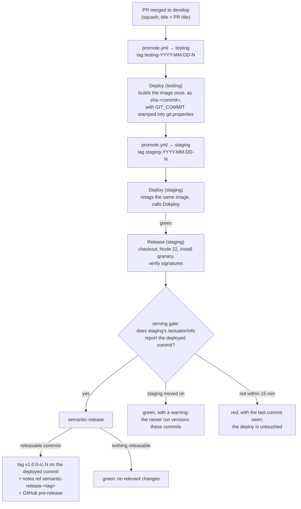

# Release versioning & commit conventions

CropDoor's versions are not typed by anyone. [semantic-release](https://semantic-release.org/) reads the commits that landed since the last version, works out the next one from their titles, and tags the commit that is actually running, once the environment is serving it. That only works if every commit title on an integration branch is a conventional commit, so the PR title, which becomes the commit title, is checked before anything merges.

This page has two parts. **[Part A](#part-a-writing-commits-and-pr-titles)** is for everyone who commits to a CropDoor repo: how a PR title becomes a commit, what the PR-title check accepts, and what each type does to the version. **[Part B](#part-b-how-release-versioning-works)** is for maintainers: the release job, the shared config package `@cropdoor/granary`, access, failures, and what changes at launch.

It covers [`cropdoor/cropdoor-backend`](https://github.com/cropdoor/cropdoor-backend) (private) and [`cropdoor/granary`](https://github.com/cropdoor/granary) (private). The frontend is **not covered yet**: its release work is parked until the CTO reopens it, so nothing on this page applies to `cropdoor-frontend` for now.

!!! info "Status"
    As of 29 Oct 2026: live on staging as an experiment. The first release candidate, `v1.0.0-rc.1`, was cut on staging's deployed commit `afdaabca` (the merge of #381) after "Analysis of 910 commits complete: major release"; its GitHub pre-release carries the whole history's notes. A "Re-run job" on that release job made no second tag, as designed. The experiment stands at **1 of 5** release candidates toward the CTO's exit review, which judges it before launch. The PR-title check and squash-only merges hold on the backend and on granary from 29 Oct. Granary is at `1.0.0`. Nothing reaches production until the official launch, whose release is `v1.0.0`. The frontend is parked.

---

## Part A: writing commits and PR titles

### Squash-only: the PR title is the commit

Both repos merge **by squash only**; merge commits and rebase merges are switched off. The squash commit's **title is the PR title** (GitHub appends the PR number, as in `… (#381)`), and its **body is the PR's commit messages**.

So the title of your PR is what counts. The individual commit messages on your branch are not checked and never become titles. They do land in the squash body, which matters for one case: a line that starts with "breaking change" (see [the warning below](#what-each-type-does-to-the-version)).

### The PR-title check

A workflow named **PR title** (`.github/workflows/pr-title.yml` in each repo, the pinned [`amannn/action-semantic-pull-request`](https://github.com/amannn/action-semantic-pull-request) v6.1.1 with its default settings) reads the title whenever a PR is opened, edited, pushed to or reopened. Fixing a refused title re-runs it; you do not need to push.

| Repo | Runs on PRs into | Required to merge into |
| --- | --- | --- |
| `cropdoor-backend` | `develop`, `testing`, `staging`, `production` | `develop` (the `cd-integration` ruleset, beside `Test & Build`) |
| `granary` | `main` | `main` |

On the backend the check also reports on a PR into an environment branch, but only `develop` requires it: environment branches normally move by `promote.yml`'s fast-forward, not by PRs.

Admins can bypass the check. They shouldn't: an unchecked title is an unchecked version bump.

A title has the shape *type*, an optional *(scope)*, an optional `!`, a colon and a space, then the *subject*: `feat(orders): …`, `fix: …`, `feat(delivery)!: …`.

**The type** is one of eleven, written in lower case:

| Type | Use it for |
| --- | --- |
| `feat` | A new capability: a new endpoint, a new flow, a new behavior users or clients can see |
| `fix` | A correction: behavior that was wrong, including security fixes |
| `perf` | A change whose point is speed or resource use, with behavior unchanged |
| `revert` | Undoing an earlier `feat`, `fix`, `perf`, `revert` or `!` change (see [Reverts](#reverts)) |
| `refactor` | Restructuring code without changing what it does |
| `docs` | Documentation only |
| `test` | Adding or correcting tests only |
| `build` | The build system or dependencies (Maven, the Dockerfile, dependency bumps; Dependabot titles its PRs `build(deps): …` or `chore(deps): …`, and both release nothing) |
| `ci` | Workflow files and CI scripts |
| `chore` | Other housekeeping that touches neither the application nor its tests |
| `style` | Formatting and import order, with no change in meaning |

**The scope** is optional, in parentheses, and free text: the check accepts any scope, and a comma-separated list such as `(orders,basket)`. **`!`** after the type or scope marks a breaking change. **The subject** is required.

What the check **refuses**:

| Title | Why it is refused |
| --- | --- |
| `check that PR titles are conventional` | No type |
| `feature: check PR titles` | Unknown type: `feature` is not one of the eleven |
| `Revert "ci: check PR titles"` | GitHub's default revert title has no type. Rename it as [Reverts](#reverts) says: here `ci: revert …` |
| `fix: ` | Empty subject |
| `FEAT: add a basket` | Types are matched in lower case only |

The check reads only the PR title. It does not look at your branch's commits or the PR description.

### What each type does to the version

Each squash commit is analyzed by its title, plus any breaking-change line in its body. A release takes the biggest bump among its commits.

| Commit | Bump | From `v1.4.2` |
| --- | --- | --- |
| A breaking change: `!` in the title (`feat!:`, `fix(auth)!:`), or a line in the message that starts with `BREAKING CHANGE` or `BREAKING-CHANGE` (see the warning below) | major | `v2.0.0` |
| `feat` | minor | `v1.5.0` |
| `fix`, `perf`, `revert` | patch | `v1.4.3` |
| `refactor`, `docs`, `test`, `build`, `ci`, `chore`, `style` | no release | `v1.4.2` stays |

The release notes have four sections, **Features**, **Bug Fixes**, **Performance** and **Reverts**, plus a **BREAKING CHANGES** section when there is one. The other types are left out of the notes, except a breaking commit of one of them, which appears under its own lower-case type heading (for example `refactor`). A `Release-As:` footer does not set the version.

!!! warning "Any line in a squashed PR that starts with “breaking change” makes a major"
    The check sees only the title, but the analyzer reads the whole squash message, and the squash body carries **every commit message in the PR**. Any line in that body that **starts** with "breaking change" or "breaking-change", in **any case**, with or without a colon, even after a `*` bullet, makes a **major** release after launch, even under a `fix:` title. So "Breaking change avoided by keeping the old field" and "* Breaking change: none" in a commit message both count. The same words in the middle of a line do not. After launch, start a line that way only for a real breaking change, and prefer marking it with `!` in the PR title, where reviewers see it. Whether the squash body keeps the commit messages at all is an [open decision for launch](#what-happens-at-launch).

**Before launch the bump does not show yet.** Until production's first release, every staging version is `1.0.0-rc.N`, whatever the types: a `feat`, a `fix` and a `!` all give the next `rc`. Only types that release anything cut a candidate, so a staging promotion of nothing but `refactor` and `test` commits gets no new `rc`. The bump rules decide real version numbers from the launch on.

### Writing good titles

Write the subject as a short statement of what the change does, in the words of the domain. Start it in lower case, unless it opens with a name or a build-item label such as `S2b` or `R1`. Drawn from the backend's history on `develop`:

| Title | Verdict (and the bump after launch) |
| --- | --- |
| `feat(orders): S2b — the later waiver of a second delivery's fee (#377)` | Good: one area, says what users get. A minor |
| `fix(auth): only an ACTIVE account and membership may hold a session, a permission or a chat socket (#378)` | Good: a security fix is a `fix`. A patch |
| `perf(documents): the download renders without holding a connection (#262)` | Good: same behavior, cheaper. A patch |
| `fix(docker): distrust the eMudhra (emSign) roots for CVE-2026-91403 (#376)` | Good: a base-image change that fixes a vulnerability in what ships is a `fix`, not `build`. A patch |
| `feat(delivery)!: only an agent or admin may mark an order delivered (B5) (#188)` | Good: removes something clients could do, so `!`. A major |
| `refactor(notifications): S0 — a builder for the order-status notification context (#369)` | Good: no behavior change, no release |
| `test(delivery): hold the HEAD in the interrupt test so it cannot race its own mock (#371)` | Good: tests only, no release |
| `build(deps): bump imjasonh/setup-crane from 0.4 to 0.7 (#319)` | Good: Dependabot's own convention. No release |
| `fix-concurrent-charges-settle (#307)` | Bad: a branch name, no type. Refused today; write `fix(payments): …` |
| `Fix/testcontainers leave no volume (#308)` | Bad: a branch prefix, not a type. Refused today; write it as `test: …` or `build: …`, whichever it is |
| `style changes` | Bad: no type, no subject. Say what changed: `style(order): group the junit imports after java` |
| `Merge pull request #163 from cropdoor/feat/multi-farm-basket` | Bad: a merge commit. Cannot happen now that merges are squash-only |

**Choosing the type.** Ask what a client or user would notice. After launch, a dependency or base-image bump that fixes a vulnerability in what ships is a `fix(…)`, so it gets a version; a routine bump stays `build(deps)` or `chore(deps)`. Something new they can do is `feat`; something that behaved wrongly and now behaves rightly is `fix`; nothing at all is `refactor`, `test`, `docs`, `build`, `ci`, `chore` or `style`, by what the files are. When a PR mixes kinds, title it by the most significant one for users: a PR with a feature and its fixes is a `feat`. After launch, `!` means a change existing clients must adapt to: a removed endpoint or transition, a changed response shape, a stricter rule that refuses what used to pass.

**Choosing the scope.** Use the domain the change belongs to, as one lower-case word or kebab-case phrase, matching what recent history uses: `orders`, `payments`, `auth`, `delivery`, `notifications`, `refunds`, `payouts`, `emails`, `documents`. Prefer the plural forms recent titles use (`orders`, `payments`, `payouts`, `emails`) over the older `order`, `payment`, `payout` and `email`. Leave the scope out when the change has no single area (`ci: …`, `docs: …`). The scope never changes the version; it shows beside the subject in the release notes.

### Reverts

GitHub's **Revert** button opens a PR titled `Revert "feat(orders): …"`, which the check refuses. Rename it `revert: feat(orders): …` and merge it as usual. The squashed `revert:` commit gives a **patch** and is listed under **Reverts** in the notes.

**Undoing a change that released nothing keeps that change's type.** A `revert:` title gives a patch, so reverting a `refactor`, `test`, `docs`, `build`, `ci`, `chore` or `style` change under it would cut a version in which nothing a user or client can see has changed. Title it by the original's type **with no scope**, as in `ci: revert "ci(release): run after staging"` or `build: revert "build(deps): bump …"`: it releases nothing, even with GitHub's "This reverts commit …" line in the squash body. The scope stays off because the analyzer reads a scope up to the last `)`, so `refactor(api): revert "refactor(api)!: …"` takes the quoted `!` as its own and makes a major. An original with `!` released a major, so its revert is `revert:`. An original with no type, from before the check, takes the type it would have today.

One subtlety: if the reverted commit and its squashed revert land in the **same** release, they do not cancel out. The two headers name different PR numbers, so the original `feat` still counts (a minor) and both are listed.

---

## Part B: how release versioning works

### What it does, and why

semantic-release runs **after a deploy, once the environment is serving the deployed commit**. It finds the last version reachable from that commit, reads every commit since, applies the rules in [Part A](#what-each-type-does-to-the-version), and if anything is releasable it tags the deployed commit, records the tag's channel in a git note, and creates a GitHub Release with the notes. Nobody types a version and nothing is committed back.

It replaced a version typed by hand into `promote.yml` and tagged at promotion time, before anything was deployed. The settled shape:

- **Versions belong to production in the end.** Until the official launch nothing moves to production, so the experiment runs on **staging**, where every deploy with releasable commits gets a release candidate `v1.0.0-rc.N`, published as a GitHub **pre-release** (never "Latest"). The launch release is `v1.0.0`. semantic-release has no `0.x`.
- **Testing and staging keep their dated tags.** `promote.yml` still tags each promotion `testing-YYYY-MM-DD-N` or `staging-YYYY-MM-DD-N` with its own pre-release, made at promotion and listing every commit type. A staging promotion therefore produces two pre-releases, the dated one and the `rc`, and both are kept through the experiment so the notes can be compared.
- **The version is not in the app.** The image is built once, on testing, and promoted by retag, so it is never stamped with a version. The app reports the commit it was built from at `/actuator/info`; to find a version, run `git tag --points-at <commit>` or open the Releases page.

### The flow

The release job starts only after `Deploy (staging)` has finished green, so nothing in it can fail or undo a deploy. A green deploy job only means Dokploy accepted the webhook, which is why the job then waits for the running app to report the commit before it tags anything.

### The pieces and where they live

**`cropdoor/granary`, published as `@cropdoor/granary`.** The shared release configuration, so every app versions itself from one tested set of rules. Its [README](https://github.com/cropdoor/granary#readme) (private) is the reference for everything below; this table is the map.

| Piece | What it is |
| --- | --- |
| The package | A semantic-release shareable config, **private** on GitHub Packages. It pins its release toolchain exactly, and each app pins granary exactly, so every app runs the tree granary tested |
| `@cropdoor/granary` | The default export, **the staging experiment**: the launch config plus `staging` as a pre-release branch (`rc`) |
| `@cropdoor/granary/production` | **The launch config**: production is the only release branch, versions are plain `vX.Y.Z`. Shipped from granary's first release, so launch day needs no granary release |
| The notes guard | GitHub refuses a release body over 125,000 characters, so both exports cut notes longer than **120,000** characters at the last whole line and add a line giving the `git log` range for the full list |
| `rehearse.js` | The **launch rehearsal**: a dry run of either export against a local mirror of an app, printing the version, the commit, the release type and the notes' length. It never tags or pushes. See the README's [launch rehearsal](https://github.com/cropdoor/granary#the-launch-rehearsal) |
| How granary versions itself | semantic-release on granary's `main`, by the apps' launch rules plus npm publishing. Each merge runs the rule tests, then tags, releases and publishes the package **only when the squash title is releasable**. Granary's `v1.0.0` is its own version, unrelated to an app's |

**The backend, [`cropdoor/cropdoor-backend`](https://github.com/cropdoor/cropdoor-backend) (private).**

| Piece | What it does |
| --- | --- |
| [`release/`](https://github.com/cropdoor/cropdoor-backend/tree/develop/release) (private) | The backend's whole share of the tooling, outside the application build. `package.json` depends on one exact granary version and sets `extends` to `@cropdoor/granary`, overriding nothing. `.npmrc` sends the `@cropdoor` scope to GitHub Packages and reads the token from the `NODE_AUTH_TOKEN` environment variable; it holds no secret. `package-lock.json` pins the whole tree (about 300 packages) with integrity hashes. `.dockerignore` keeps `release/` out of the image's build context |
| The `release` job in [`deploy.yml`](https://github.com/cropdoor/cropdoor-backend/blob/develop/.github/workflows/deploy.yml) (private) | `needs: deploy`, runs only on `staging` until launch, one at a time per environment (`concurrency: release-<branch>`), 30-minute timeout. Steps: check out the deployed commit with full history and tags; set up Node 22, with no package cache because the job holds a write token; install from `release/` with `npm ci --ignore-scripts` and check registry signatures with `npm audit signatures`; **the serving gate**; then `semantic-release`, whose exit code decides the job. The install comes before the gate on purpose, so seconds, rather than the length of the install, separate "serving" from semantic-release's own branch check |
| The serving gate | Polls staging's `/actuator/info` every 20 seconds for up to 15 minutes until `git.commit.id` equals the deployed commit's first seven characters. Stops early, green with a warning, if a newer commit lands on the branch. Times out red, naming the last commit it saw |
| The [`Dockerfile`](https://github.com/cropdoor/cropdoor-backend/blob/develop/Dockerfile) (private) | Takes `ARG GIT_COMMIT=unknown` and writes `git.commit.id=<commit>` into `src/main/resources/git.properties` before packaging. `.dockerignore` excludes `.git/`, so the build cannot read git itself. `deploy.yml`'s testing build passes the commit as the build argument; staging and production retag those same bytes, so the commit inside is the commit every environment runs. A local Docker build, or `ci.yml`'s image check, passes no argument and reports `unknown`; a plain `./mvnw` run writes no `git.properties`, so its `/actuator/info` has no `git` field |
| `/actuator/info`'s `git` field | Spring Boot's own git info contributor in its default **simple mode**: the response's `git` is `{"commit":{"id":"<7 characters>"}}`. Simple mode can never publish more than the id, branch and time, even if a fuller `git.properties` with author emails and remote URLs appears one day on this public endpoint. `ActuatorExposureIT` pins that exact shape against a fixture with extra fields, and still pins that no environment value leaks |
| [`pr-title.yml`](https://github.com/cropdoor/cropdoor-backend/blob/develop/.github/workflows/pr-title.yml) (private) | The PR-title check of [Part A](#the-pr-title-check) |

### Access

- **The package is private.** Only repos granted access can install it.
- **Each app repo needs Read.** In the package's settings on GitHub (the `cropdoor` organization's packages, `granary`, then **Manage Actions access**), an organization admin adds the app repo with the **Read** role. Without the grant the release job's install fails. `cropdoor-backend` has it. Granary's own workflows have access because the package is linked to its repo.
- **The release job uses its own `GITHUB_TOKEN`**, with `packages: read` to install granary and `contents: write` to push the tag, the notes ref and the Release. The release job uses no personal token (unlike `promote.yml`, which pushes with one). There is no tag ruleset in the way; if one is added later, the tag push is refused and the job goes red until GitHub Actions is given a bypass for `v*`.
- **A person installing `release/` locally** (to refresh the lockfile, or for a dry run) needs a **classic** personal access token with the `read:packages` scope, exported as `NODE_AUTH_TOKEN` for that one command.
- **Nothing is committed with a token.** `.npmrc` names the environment variable, not a value.

### Changing the rules

1. **Change granary in a PR** into its `main`. Its CI runs the rule tests. **The PR title decides whether anything is published**, because granary releases itself by the same rules: only `feat`, `fix`, `perf`, `revert` or a `!` publishes a new version. A rule change changes what every app releases, so it is a `feat!:`. A pin bump the apps should take needs a releasable type too (a `fix(…)`, for example): a `build(deps): …` title merges and publishes nothing.
2. **Merge it.** Granary's CI publishes the new version of `@cropdoor/granary` and its GitHub Release. No app changes yet.
3. **Each app takes the new version through a lockfile PR** that bumps the exact version in `release/package.json` and regenerates `release/package-lock.json`. Before that PR merges, its author runs semantic-release's **dry run by hand**: `semantic-release --dry-run` from `release/`, in a clone on `staging`, with a repo-scoped token. It has to run locally, because in the PR's own CI it stops at "This run was triggered by a pull request". That dry run is for an app's `release/` only: [never dry-run granary's own release on your machine](https://github.com/cropdoor/granary#how-granary-releases-itself), because its npm plugin copies your `~/.npmrc` tokens into a temporary file it never deletes.
4. **To preview what a bump would release**, follow granary's README, [Previewing a granary bump](https://github.com/cropdoor/granary#previewing-a-granary-bump).

### When something goes wrong

The deploy is never affected: the release job runs after it has finished. A failure turns the release job and the run red, and GitHub emails the actor.

| What you see | What it means, and what to do |
| --- | --- |
| **The release job is red** | Open the failing step. An install failure is usually the package's Read grant or the registry. A failing `npm audit signatures` is a supply-chain alarm: investigate which package failed and why before anything else, and do not just re-run. A semantic-release failure before tagging leaves no tag. Fix the cause, then use **Re-run failed jobs** on that run (or "Re-run job" on `Release (staging)`). A re-run never makes a second version or moves a tag |
| **A tag landed without its notes ref** | semantic-release pushes the tag, then the note. If the note push failed, the tag is not on staging's channel, and that run and every later staging run fail with "tag … already exists". **If staging has not moved since**, delete the tag and its notes ref together, `git push origin :refs/tags/<tag> :refs/notes/semantic-release-<tag>`, and Re-run failed jobs: the same version is made again, with its note and Release. **If staging has moved**, deleting would not help (the old run's re-run goes green at "behind the remote one" and makes nothing), so repair by hand: `git fetch origin tag <tag>`; then `git notes --ref semantic-release-<tag> add -f -m '{"channels":["staging"]}' <tag>`; then `git push origin refs/notes/semantic-release-<tag>`; then `gh release create <tag> --verify-tag --title <tag> --prerelease --generate-notes`; then Re-run failed jobs on the **newest** staging run, which failed on the existing tag. **Never delete a notes ref** except together with its own tag: the `rc` chain depends on them |
| **A tag and note landed without a Release** | A re-run makes nothing, because the tag is already on the commit. Create the pre-release by hand with `gh release create <tag> --verify-tag --title <tag> --prerelease --generate-notes` (its notes are GitHub's list of merged PRs, not ours). Or, **only if staging has not moved**, delete the tag and its notes ref with `git push origin :refs/tags/<tag> :refs/notes/semantic-release-<tag>` and Re-run failed jobs |
| **The gate timed out** | Its error, "staging is not serving `<commit>`", gives the last commit it saw and the last `curl` exit status. An older commit means the new container never took over or is still booting. `null` means the app answered with no `git` field (an image without the commit report). `none` means `curl` got no usable answer, and the exit status says why: `22`, the app or the edge answered with an HTTP error status (a 502 during the container swap, a 403 from the edge); `6`, `7` or `28`, DNS, connection or timeout; `0`, a 2xx that was not JSON. Fix the container; once it serves the commit, Re-run failed jobs. Otherwise the next staging deploy versions these commits |
| **"Not versioned: staging moved on"** | Green, with a warning: a newer commit reached staging during the wait, and its run versions these commits too if its deploy and release succeed. Nothing to do. semantic-release's "behind the remote one" line is the same case caught a few seconds later |
| **The release job shows "cancelled"** | A newer staging run was queued behind it and replaced it before it started. Nothing to do: the newer commit contains this one's, and its run versions both |
| **Re-running** | Use **Re-run failed jobs**, or **Re-run job** on the release job alone. **Never "Re-run all jobs"**: it re-runs the deploy of that run's commit, which restarts the app and, if staging has moved on since, rolls it back to the older commit |
| **Stopping the experiment** | There is no switch. A PR removes the `release` job and `release/`, then a promotion to staging carries it, because staging runs the `deploy.yml` of the commit it holds. Until that promotion a red release job harms nothing. The PR-title check and the commit report stay; the `rc` tags can be left, since production ignores pre-release tags |

### What happens at launch

The CTO judges the experiment before launch, against nine exit criteria: at least five `rc`s each cut with its tag, note and pre-release and no hand repair, the analyzer's type right for each, no deploy affected, every staging deploy accounted for, failures red and recovered, a re-run that made no duplicate, the notes useful, no unconventional squash commit since the check went live, and `/actuator/info` reporting the deployed commit. The switch itself waits for the launch.

- **One backend PR, merged before the launch candidate is promoted to testing**, so the launch commit carries it:
  - `release/package.json` switches `extends` to `@cropdoor/granary/production`; the lockfile does not change and no granary release is needed;
  - the `release` job's `if` moves from `staging` to `production` (the gate already knows production's URL), so staging stops cutting `rc`s and keeps its dated tags;
  - `promote.yml`'s typed production version goes: the `version` input and its validation are deleted, and the production promotion makes no tag and no Release of its own;
  - Dependabot gets an entry for `release/`.
- **Production is realigned.** Production holds commits staging does not, so the first production promotion uses `promote.yml`'s `force` option to put production onto staging's history.
- **`v1.0.0`.** `Deploy (production)` runs, then `Release (production)` waits for production's `/actuator/info` to report the launch commit and cuts `v1.0.0` on it: a full Release, marked Latest, with the whole history's notes (cut by the guard if they pass 120,000 characters). `rc` tags are ignored. From then on `fix` gives `v1.0.1`, `feat` `v1.1.0`, and `!` `v2.0.0`.
- **An open decision: the squash commit's body.** Because the body carries the PR's commit messages, any line in them that starts with "breaking change" (in any case, [as above](#what-each-type-does-to-the-version)) makes a major after launch. The CTO decides before the switch between keeping the commit messages (today), a **blank** body (engineering's recommendation: the checked title is the only input, and breaking changes are marked with `!` where reviewers see them), and the PR description.
- **Not on this page:** production's own launch-day deploy steps, such as the migration checks and any per-environment step a feature carries.

The launch rehearsal (granary's `rehearse.js`, against a mirror of the backend) runs once the launch date is set, to see the version and notes length before they happen.
